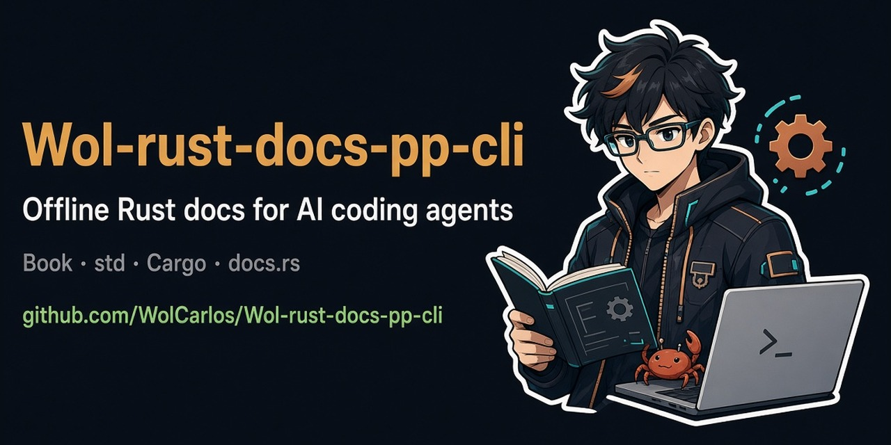

# rust-docs-pp-cli

**[English](README.md)** | **[Italiano](README.it.md)**

<p align="center">
  
</p>

CLI offline, progettata per gli agenti AI, dedicata al Rust Book, alla Rust Reference, al Cargo Book, a Rust by Example, alla standard library e ai crate documentati su docs.rs.

```bash
rust-docs-pp-cli which "borrow checker" --json
rust-docs-pp-cli context ch04-02-references-and-borrowing --json
rust-docs-pp-cli examples "Vec::new" --language rust --json
```

La CLI scarica la documentazione pubblica in un indice locale SQLite + FTS5. Successivamente, i comandi di consultazione funzionano offline e restituiscono risultati di ricerca limitati oppure esattamente la pagina o l'esempio richiesto, evitando ripetute navigazioni web e consumi di token non necessari.

Creata e mantenuta da [WolCarlos](https://github.com/WolCarlos), con assistenza allo sviluppo da parte di **Kimi K3.1** di Moonshot AI.

## Funzionalità

- `which` e `find`: ricerca full-text delle pagine con ranking e frammenti contestuali.
- `context`: contenuto completo di una pagina tramite slug, percorso o URL.
- `examples`: ricerca nei blocchi di codice con filtri per linguaggio e fonte.
- `sections` e `doctor`: mappa dell'indice, conteggi, stato delle sincronizzazioni e percorso del database.
- Output JSON per ogni comando, risultati compatti ed exit code tipizzati.
- Sostituzione atomica di ogni fonte: un aggiornamento fallito non elimina l'indice precedente.
- Nessuna dipendenza runtime oltre a Python 3.11+ e al supporto SQLite FTS5 incluso.

## Installazione

Con [uv](https://docs.astral.sh/uv/):

```bash
uv tool install git+https://github.com/WolCarlos/Wol-rust-docs-pp-cli.git
rust-docs-pp-cli sync
```

Oppure con pip:

```bash
python -m pip install git+https://github.com/WolCarlos/Wol-rust-docs-pp-cli.git
rust-docs-pp-cli sync
```

Il comando `sync` predefinito scarica le quattro fonti mdBook ufficiali. Non sono necessari toolchain Rust o Go, account o API key. Se il comando non viene trovato dopo l'installazione, verifica che la cartella degli eseguibili di uv o pip sia presente nel `PATH`, oppure apri una nuova shell.

Per l'installazione guidata su sistemi Unix-like:

```bash
curl -sSf https://raw.githubusercontent.com/WolCarlos/Wol-rust-docs-pp-cli/main/install.sh | bash
```

Su Windows PowerShell:

```powershell
irm https://raw.githubusercontent.com/WolCarlos/Wol-rust-docs-pp-cli/main/install.ps1 | iex
```

## Configurazione per agenti di coding AI

La CLI funziona con Claude Code, Codex, Cursor e altri agenti di coding in grado di eseguire comandi shell locali. Non richiede un server MCP, un account o credenziali API.

### 1. Installa e verifica l'ambiente dell'agente

Installa la CLI nello stesso ambiente utilizzato dall'agente, quindi crea e verifica l'indice locale:

```bash
uv tool install git+https://github.com/WolCarlos/Wol-rust-docs-pp-cli.git
rust-docs-pp-cli version
rust-docs-pp-cli sync
rust-docs-pp-cli doctor --json
rust-docs-pp-cli which "ownership and borrowing" --json
```

Facoltativamente, indicizza la standard library stabile e i crate utilizzati dal progetto:

```bash
rust-docs-pp-cli sync std
rust-docs-pp-cli sync crate serde --max-pages 300
rust-docs-pp-cli sync crate tokio --max-pages 300
```

Se il comando non viene trovato, riavvia il terminale dell'agente e verifica che la cartella degli eseguibili di uv o pip sia presente nel `PATH`. L'agente deve avere il permesso di eseguire `rust-docs-pp-cli` e di leggere e scrivere il database locale. Per un indice isolato nel progetto, usa `--db /percorso/progetto.db` oppure imposta `RUST_DOCS_DB`; non inserire il database generato nel controllo di versione.

### 2. Aggiungi le istruzioni operative per l'agente

Aggiungi il blocco seguente al file `AGENTS.md` del progetto oppure alle istruzioni persistenti equivalenti del tuo agente. Il blocco è generico e non contiene configurazioni specifiche della macchina.

```markdown
### Documentazione Rust

Per domande sul linguaggio Rust, sulla standard library, su Cargo o sui crate, usa `rust-docs-pp-cli` invece di affidarti soltanto alla memoria del modello:

1. Esegui `rust-docs-pp-cli which "argomento" --json` per trovare le pagine rilevanti.
2. Esegui `rust-docs-pp-cli context "slug-o-url" --json` usando uno slug o un URL restituito da `which`; non inventare slug.
3. Per esempi di codice, esegui `rust-docs-pp-cli examples "simbolo o argomento" --language rust --json`.
4. Per un crate non indicizzato, esegui `rust-docs-pp-cli sync crate "nome-crate" --max-pages 300`, quindi aggiungi `--source crate:nome-crate` alle ricerche.
5. Basa le risposte sulla documentazione recuperata e cita il relativo URL. Se i risultati sono vuoti o obsoleti, esegui `rust-docs-pp-cli doctor --json`; aggiorna con `sync`, `sync std` oppure il comando `sync crate` appropriato.
```

### 3. Verifica il flusso configurato

Chiedi all'agente, per esempio, "Come funziona l'ownership in Rust?" e verifica che esegua prima `which`, legga la pagina selezionata con `context` e citi l'URL della documentazione ufficiale. Usa `doctor --json` per diagnosticare un indice vuoto o non aggiornato senza leggere i file di configurazione locali.

## Fonti della documentazione

| Fonte | Comando di sincronizzazione | Contenuto |
|---|---|---|
| Rust Book | `rust-docs-pp-cli sync book` | Markdown ufficiale di `rust-lang/book`, inclusi i listati referenziati |
| Rust Reference | `rust-docs-pp-cli sync reference` | Reference ufficiale del linguaggio |
| Cargo Book | `rust-docs-pp-cli sync cargo` | Guida, comandi e reference di Cargo |
| Rust by Example | `rust-docs-pp-cli sync rust-by-example` | Esempi eseguibili e spiegazioni |
| `std`, `core`, `alloc` | `rust-docs-pp-cli sync std` | Archivio rustdoc stabile ufficiale per il target dell'host |
| Qualsiasi crate su docs.rs | `rust-docs-pp-cli sync crate serde` | Pagina principale del crate e pagine rustdoc ricavate dal relativo indice `all.html` |
| Una singola pagina rustdoc | `rust-docs-pp-cli sync url <url>` | Una pagina di doc.rust-lang.org o docs.rs |

`sync` senza sottocomandi aggiorna Book, Reference, Cargo e Rust by Example. `sync official book cargo` aggiorna soltanto le fonti mdBook selezionate.

L'archivio della standard library è più grande delle fonti mdBook: circa 24 MB compressi, mentre l'indice di ricerca estratto occupa più spazio. Il relativo SHA-256 viene verificato tramite il manifest ufficiale di Rust stabile.

Per i crate, `--version` è impostato su `latest` e `--max-pages` ha valore predefinito 300, includendo la pagina principale del crate:

```bash
rust-docs-pp-cli sync crate tokio --version latest --max-pages 300
rust-docs-pp-cli sync crate serde --max-pages 0   # tutte le pagine degli elementi
rust-docs-pp-cli sync url https://docs.rs/serde/latest/serde/trait.Serialize.html
```

Una sincronizzazione incompleta di un crate viene segnalata con `"truncated": true`. Usa `--max-pages 0` quando è necessaria la copertura completa. I download dei crate utilizzano al massimo quattro richieste concorrenti in sola lettura.

## Flusso di lavoro per gli agenti

Inizia sempre con `which`, quindi passa lo slug o l'URL restituito a `context`. Non inventare slug.

```bash
# 1. Trova un insieme limitato di pagine candidate.
rust-docs-pp-cli which "how do lifetimes work" -n 3 --json

# 2. Leggi soltanto la pagina selezionata.
rust-docs-pp-cli context ch10-03-lifetime-syntax --json

# 3. Facoltativamente, recupera esempi di codice pertinenti.
rust-docs-pp-cli examples "lifetime annotation" --language rust -n 3 --json
```

Filtri utili:

```bash
rust-docs-pp-cli which "Vec push capacity" --source std --json
rust-docs-pp-cli which "Serialize derive" --source crate:serde --json
rust-docs-pp-cli examples "cargo test" --source cargo --language bash --json
rust-docs-pp-cli which "ownership" --compact --json
```

Tutti i comandi di consultazione funzionano offline. Esegui nuovamente `sync` quando la documentazione deve essere aggiornata; `doctor --json` mostra i timestamp di sincronizzazione di ogni fonte.

## Riferimento dei comandi

| Comando | Funzione |
|---|---|
| `sync [official] [SOURCES...]` | Aggiorna tutte le fonti mdBook ufficiali o solo quelle selezionate |
| `sync std` | Aggiorna il rustdoc stabile di `std`, `core` e `alloc` |
| `sync crate NAME [--version V] [--max-pages N]` | Aggiorna un crate da docs.rs |
| `sync url URL` | Memorizza nella cache una pagina rustdoc supportata |
| `which QUERY [-n N] [--source S]` | Restituisce le cinque migliori pagine candidate |
| `find QUERY [-n N] [--source S]` | Restituisce dieci risultati di ricerca full-text |
| `context SLUG_OR_URL` | Restituisce una pagina completa |
| `examples QUERY [-n N] [--language L] [--source S]` | Restituisce i blocchi di codice pertinenti |
| `sections [--source S]` | Elenca sezioni e numero di pagine |
| `doctor` | Mostra lo stato del database e delle sincronizzazioni |
| `version` | Mostra la versione della CLI |

Le opzioni globali possono essere inserite prima o dopo il sottocomando:

- `--json`: output machine-readable su stdout.
- `--compact`: elimina frammenti e ranking dai risultati di ricerca.
- `--db PATH`: sostituisce il percorso predefinito del database. È supportata anche la variabile d'ambiente `RUST_DOCS_DB`.

Le ricerche senza risultati restituiscono un array `matches` o `examples` vuoto. Un comando `context` con pagina mancante o ambigua termina con exit code 3 e, in modalità JSON, include le pagine candidate quando il risultato è ambiguo. Gli errori di rete o della fonte usano l'exit code 5, gli errori di parsing degli argomenti il 2 e gli errori imprevisti l'1.

## Archiviazione dei dati

Percorsi predefiniti del database:

- Windows: `%LOCALAPPDATA%\rust-docs-pp-cli\data.db`
- macOS: `~/Library/Application Support/rust-docs-pp-cli/data.db`
- Linux/Unix: `${XDG_DATA_HOME:-~/.local/share}/rust-docs-pp-cli/data.db`

La documentazione scaricata viene conservata soltanto in questo database locale. La repository non contiene copie della documentazione Rust, credenziali, database locali o artefatti di analisi.

## Sviluppo

```bash
git clone https://github.com/WolCarlos/Wol-rust-docs-pp-cli.git
cd Wol-rust-docs-pp-cli
uv venv
uv pip install -e .

# Unix
. .venv/bin/activate
# Windows PowerShell: .venv\Scripts\Activate.ps1

PYTHONPATH=src python -m unittest discover -s tests -v
rust-docs-pp-cli sync book --db ./dev.db
rust-docs-pp-cli which "ownership" --db ./dev.db --json
```

Su Windows CMD, imposta `PYTHONPATH=src` prima di eseguire i test. La suite è offline; i formati delle fonti vengono verificati separatamente tramite smoke test sulla documentazione ufficiale.

## Asset grafici

Gli asset visivi del progetto sono disponibili nella cartella `assets/brand/`:

| Asset | File | Dimensioni |
|---|---|---|
| Immagine profilo quadrata | [`profile.jpg`](assets/brand/profile.jpg) | 1024×1024 |
| Mascotte principale | [`mascot.jpg`](assets/brand/mascot.jpg) | 784×1168 |
| Mascotte verticale | [`mascot-tall.jpg`](assets/brand/mascot-tall.jpg) | 784×1168 |
| Anteprima social per GitHub | [`social-preview.jpg`](assets/brand/social-preview.jpg) | 1280×640 |

Le immagini sono state generate con Grok utilizzando prompt di art direction creati specificamente per questo progetto. Il file per l'anteprima social è mostrato anche all'inizio di entrambe le versioni del README.

## Fonti e ispirazione

- [CLI Printing Press](https://github.com/mvanhorn/cli-printing-press): principi di CLI agent-native, SQLite locale, verifica ed efficienza dei token.
- [agno-docs-pp-cli](https://github.com/sekai1710/agno-docs-pp-cli): flusso documentale `which` → `context` → `examples` e progettazione dell'indice SQLite FTS5.
- [The Rust Programming Language](https://github.com/rust-lang/book), [Rust Reference](https://github.com/rust-lang/reference), [Cargo](https://github.com/rust-lang/cargo) e [Rust by Example](https://github.com/rust-lang/rust-by-example).
- [Documentazione della standard library Rust](https://doc.rust-lang.org/std/) e [docs.rs](https://docs.rs/).

La documentazione Rust resta soggetta alle licenze dei rispettivi progetti upstream. Questa repository contiene l'implementazione del sistema di consultazione, non una copia ridistribuita della documentazione.

## Licenza

MIT. Consulta [LICENSE](LICENSE).
